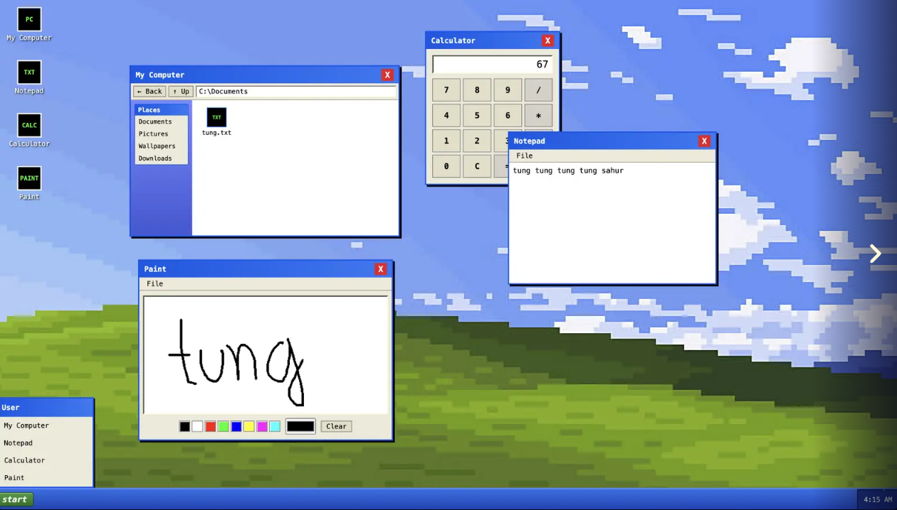

# 8 Bit OS

A retro Windows XP-styled OS that runs entirely in your browser.



[Try it live ](https://8-bit-os.vercel.app)

## Quick start

Open the link above. That's it.

## Features

- Draggable and closeable windows
- Start menu and live clock
- File Explorer with Documents, Pictures, Wallpapers and Downloads folders
- Notepad for jotting text, save your notes to the file manager
- Paint app with a canvas, color picker, and preset swatches, save your drawings to the file manager
- Saved files show up in the file manager, double-click to open them again in Notepad or Paint
- Local storage system, your files are still there after you refresh the page
- Calculator that does real calculation (type `67` and press `=` for a surprise)
```bash
git clone https://github.com/raiyan-islam-dev/8-Bit-OS.git
cd 8-Bit-OS
```

Then open `index.html` in your browser.

## How it works

- **Draggable Windows:** Tracks mouse clicks on the top bar to move windows around the screen.
- **File Explorer:** A folder tree of files and folders that you can browse, save into and open from.
- **Local Storage:** Saved notes and drawings are kept in your browser's local storage, so they persist between visits (on the same browser).
- **Calculator:** Uses standard JS evaluation to do math directly from the button inputs.
- **Paint App:** Uses HTML Canvas to draw smooth lines wherever you move your mouse.
## Credits

Built for Hack Club's Stardance WebOS2 mission. Color palette references the Windows XP Luna theme.

## AI Declaration

AI helped me with:
- debugging
- cleaning up and polishing my code
- designing some UI elements
- the file system logic